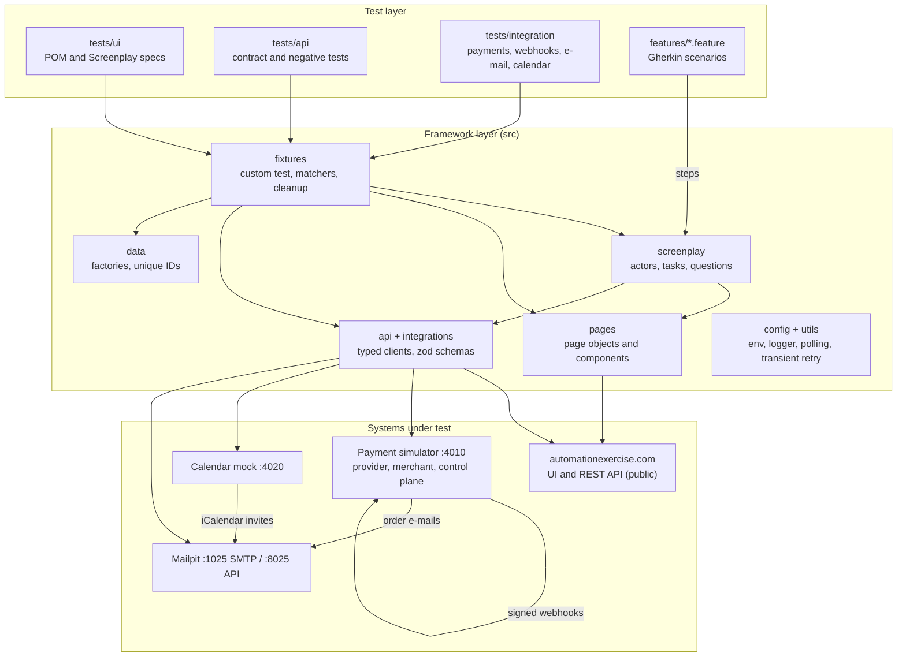
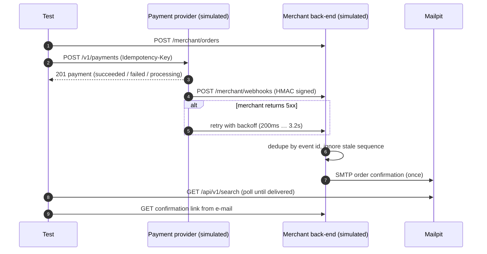

# E-commerce E2E Test Automation Framework

Playwright + TypeScript framework that tests a public demo shop
([Automation Exercise](https://automationexercise.com)) through its UI and REST API, and tests
payment, webhook, e-mail and calendar integrations against local services that run on the
developer's machine or CI runner.

The project is a portfolio piece. It is built to show how a framework is structured, not just
how individual tests are written: layered page objects and Screenplay tasks, typed API clients
with contract validation, custom fixtures with automatic test data cleanup, deterministic
fault injection, and a CI pipeline with quality gates.

---

## Contents

- [Project overview](#project-overview)
- [Tech stack](#tech-stack)
- [Framework architecture](#framework-architecture)
- [Project structure](#project-structure)
- [Getting started](#getting-started)
- [Running tests](#running-tests)
- [Test coverage](#test-coverage)
- [Design patterns](#design-patterns)
- [Third-party integrations](#third-party-integrations)
- [CI/CD](#cicd)
- [Test reporting](#test-reporting)
- [Test strategy](#test-strategy)
- [Known limitations](#known-limitations)
- [Author](#author)

---

## Project overview

**What is tested**

| Area                                                       | System                                                                                               | Real or simulated                                         |
| ---------------------------------------------------------- | ---------------------------------------------------------------------------------------------------- | --------------------------------------------------------- |
| Login, logout, session                                     | automationexercise.com UI                                                                            | Real (public demo site)                                   |
| Catalogue, search, category/brand filters, product details | automationexercise.com UI + API                                                                      | Real                                                      |
| Cart and checkout                                          | automationexercise.com UI                                                                            | Real; the demo's payment form accepts any card, no charge |
| Account and product API                                    | automationexercise.com `/api/*` (documented at [/api_list](https://automationexercise.com/api_list)) | Real                                                      |
| Payments, idempotency, subscriptions                       | `services/payment` (local simulator)                                                                 | **Simulated**                                             |
| Payment webhooks                                           | `services/payment` merchant endpoint                                                                 | **Simulated**                                             |
| Transactional e-mail                                       | [Mailpit](https://mailpit.axllent.org) SMTP server                                                   | **Local** (real SMTP, no external delivery)               |
| Delivery appointment calendar                              | `services/calendar` (local mock)                                                                     | **Simulated**                                             |

**Why this application.** Automation Exercise was chosen after checking several public demo
shops. It supports registration and login, a catalogue with search and category/brand
filters, a server-side cart, checkout with an order confirmation, and, unlike most demo
shops, a documented public API. Every endpoint and UI behaviour used here was checked against
the live site before tests were written.

**Why local services.** The demo shop has no payment provider, webhooks, e-mail or calendar.
Testing those against real sandboxes would need paid accounts and would be
non-deterministic. The local services are small, self-contained HTTP servers that behave
like a provider sandbox (test cards, signed webhooks with retries, optimistic concurrency) and
add a fault-injection API. That lets tests trigger duplicate deliveries, out-of-order events and
back-end outages on demand.

**Problems the architecture addresses**

- _Locator duplication_: Screenplay tasks reuse the page objects instead of defining their own
  selectors.
- _Shared-state flakiness_: every test creates its own user, order or calendar, with IDs that
  include the worker index.
- _Opaque API failures_: responses are validated against zod contracts, and failures print the
  URL, the schema issues and the body.
- _Third-party noise_: ad and analytics hosts that inject full-screen interstitials are blocked
  at the network layer.
- _Public-site instability_: when the shop sheds load ("queue full"), navigation and API calls
  retry up to three times. Each retry is recorded as a test annotation, so it is never hidden.

## Tech stack

| Technology                                                                  | Version      | Why                                                                                                                 |
| --------------------------------------------------------------------------- | ------------ | ------------------------------------------------------------------------------------------------------------------- |
| [Playwright Test](https://playwright.dev)                                   | 1.65         | Auto-waiting, fixtures, parallel workers, traces, built-in `APIRequestContext` for API tests in the same runner     |
| TypeScript                                                                  | 6.0 (strict) | Type-safe page objects, clients and fixtures. 6.0 rather than 7.0 because `typescript-eslint` 8.x supports TS < 6.1 |
| [zod](https://zod.dev)                                                      | 4            | Runtime response contracts and environment validation                                                               |
| [playwright-bdd](https://vitalets.github.io/playwright-bdd)                 | 9            | Gherkin scenarios compiled to native Playwright tests, so BDD runs on the same fixtures, reporters and workers      |
| [Mailpit](https://mailpit.axllent.org)                                      | 1.34         | Local SMTP server with a REST API for e-mail assertions                                                             |
| Node.js `http`                                                              | 24           | Payment and calendar simulators. No web framework needed for a few JSON routes                                      |
| nodemailer                                                                  | 10           | SMTP client used by the simulators                                                                                  |
| ESLint + typescript-eslint (`strictTypeChecked`) + eslint-plugin-playwright | 10 / 8 / 2   | Catches floating promises, `waitForTimeout`, `force: true`, focused/skipped tests                                   |
| Prettier                                                                    | 3            | Formatting gate                                                                                                     |
| GitHub Actions                                                              | —            | CI with PR checks, manual dispatch and a nightly cross-browser run                                                  |

## Framework architecture



How a test executes:

1. The spec imports `test` and `expect` from `src/fixtures`. The fixtures build only what the
   test asks for: page objects, API clients, a registered user (deleted afterwards), or a
   Screenplay actor.
2. UI tests drive **page objects** directly (POM style), or ask an **actor** to perform
   **tasks** (Screenplay style). Tasks call the same page objects, so selectors live in one place.
3. API and integration tests use **typed clients** built on Playwright's `APIRequestContext`.
   Responses are parsed through **zod schemas**, so a contract break fails with a precise message.
4. Playwright's `webServer` starts Mailpit and the simulators before the run, or reuses them if
   they are already running.

More detail: [docs/architecture.md](docs/architecture.md).

## Project structure

```text
.
├── .github/workflows/playwright.yml   CI pipeline (static checks → API → smoke → regression)
├── docs/                              architecture, test strategy, CI/CD guides
├── features/                          BDD layer
│   ├── checkout.feature               UI checkout scenarios
│   ├── payment-webhooks.feature       payment/webhook scenarios
│   └── steps/                         step definitions (thin adapters over Screenplay and clients)
├── scripts/install-mailpit.sh         downloads a pinned Mailpit binary into .tools/ (gitignored)
├── services/                          local simulated third parties
│   ├── payment/                       payment provider + merchant back-end + fault injection
│   ├── calendar/                      appointment calendar with iCalendar e-mail invites
│   ├── shared/                        tiny JSON router, SMTP mailer, HMAC webhook signatures
│   └── start-services.ts              starts both simulators in one process
├── src/
│   ├── api/                           Automation Exercise API client + zod response schemas
│   ├── config/env.ts                  validated environment configuration
│   ├── data/                          test data factories (users, cards, orders, events)
│   ├── fixtures/                      custom Playwright fixtures and custom matchers
│   ├── integrations/                  Mailpit, payment, webhook and calendar clients
│   ├── pages/                         page objects and shared components (header, modal)
│   ├── screenplay/                    actor, abilities, interactions, tasks, questions
│   └── utils/                         logger, polling, transient-error retry, helpers
├── tests/
│   ├── api/                           public API tests
│   ├── integration/                   tests against the local services
│   └── ui/                            browser tests against the demo shop
├── .env.example                       every configurable value with its local default
├── eslint.config.js
├── playwright.config.ts               projects, reporters, web servers
└── tsconfig.json
```

Generated and local-only folders (`.features-gen/`, `reports/`, `test-results/`, `.tools/`)
are gitignored.

## Getting started

Prerequisites: Node.js 20 or newer (CI uses 24, see `.nvmrc`), npm, Git, and `curl` + `tar`
for the Mailpit download. Docker is **not** required.

```bash
# 1. Clone
git clone https://github.com/GalaganI/E2E.git
cd E2E

# 2. Install dependencies
npm ci

# 3. Install the browser (add --with-deps on Linux to install system libraries)
npx playwright install chromium

# 4. Install the Mailpit binary into ./.tools/mailpit (macOS and Linux, amd64/arm64)
npm run services:install

# 5. Optional: override defaults (base URL, ports, test-only keys)
cp .env.example .env

# 6. Run a first test suite (Playwright starts Mailpit and the simulators automatically)
npm run test:integration
```

**Starting the local services manually** is optional, since Playwright starts them on demand
and reuses running instances. Running them separately is useful for exploring the APIs or
watching mail in the Mailpit web UI at <http://127.0.0.1:8025>:

```bash
npm run mailpit:start      # terminal 1: SMTP on :1025, UI/API on :8025
npm run services:start     # terminal 2: payment simulator on :4010, calendar mock on :4020
curl http://127.0.0.1:4010/health
```

## Running tests

| Goal                               | Command                                                                                                                  |
| ---------------------------------- | ------------------------------------------------------------------------------------------------------------------------ |
| Everything (all projects)          | `npm test`                                                                                                               |
| Smoke suite                        | `npm run test:smoke`                                                                                                     |
| Regression suite                   | `npm run test:regression`                                                                                                |
| API tests (public shop API)        | `npm run test:api`                                                                                                       |
| UI tests (Chromium)                | `npm run test:ui`                                                                                                        |
| Integration tests (local services) | `npm run test:integration`                                                                                               |
| BDD scenarios                      | `npm run test:bdd`                                                                                                       |
| Headed browser                     | `npm run test:headed`                                                                                                    |
| Debug with Playwright Inspector    | `npm run test:debug -- tests/ui/auth.spec.ts`                                                                            |
| One file / one test by title       | `npx playwright test tests/ui/cart.spec.ts` / `npx playwright test -g "duplicate delivery"`                              |
| Firefox / WebKit                   | `npx playwright install firefox webkit` then `CROSS_BROWSER=true npx playwright test --project=firefox --project=webkit` |
| Parallelism                        | `npx playwright test --workers=4` (default is 3; see [Test strategy](#test-strategy))                                    |
| Open the last HTML report          | `npm run report`                                                                                                         |
| Lint, format check, type check     | `npm run check`                                                                                                          |

`npm test`, `test:smoke`, `test:regression`, `test:bdd` and `typecheck` regenerate the BDD
specs (`bddgen`) first. When calling `npx playwright test` directly with the `bdd` project,
run `npx bddgen` first.

## Test coverage

111 tests in total: 16 tagged `@smoke` and 95 tagged `@regression`; every test has exactly
one of the two tags. The counts come from `npx playwright test --list`.

| Area                   | Type                       | Spec                                      | Tests | What is covered                                                                                                                                                                                                                      |
| ---------------------- | -------------------------- | ----------------------------------------- | ----- | ------------------------------------------------------------------------------------------------------------------------------------------------------------------------------------------------------------------------------------ |
| Authentication         | UI (POM)                   | `tests/ui/auth.spec.ts`                   | 8     | valid/invalid login, e-mail format validation, session persistence across reloads and contexts, logout invalidates the cookie, login required before checkout, **known defect**: `/checkout` reachable anonymously                   |
| Catalogue              | UI (POM) + API cross-check | `tests/ui/catalog.spec.ts`                | 6     | full listing vs API, search (UI = API results), empty search, category filter, brand filter, product details and availability                                                                                                        |
| Cart                   | UI (POM)                   | `tests/ui/cart.spec.ts`                   | 5     | add/remove, quantity accumulation, line totals vs catalogue prices, persistence across reload, persistence across sessions/devices                                                                                                   |
| Checkout               | UI (Screenplay)            | `tests/ui/checkout.spec.ts`               | 7     | successful order with total check, delivery address, payment form validation, recovery after a failed payment submission (injected HTTP 503), no double submission, new customer flow, **known defect**: empty-cart payment accepted |
| Products API           | API                        | `tests/api/products.api.spec.ts`          | 10    | schema, unsupported methods (405), brand consistency, search semantics, missing params (400), concurrent reads                                                                                                                       |
| Accounts API           | API                        | `tests/api/accounts.api.spec.ts`          | 11    | CRUD lifecycle consistency, duplicate e-mail, wrong/missing credentials, delete without password, invalid payloads, concurrent duplicate registration                                                                                |
| Payments               | Integration                | `tests/integration/payments.spec.ts`      | 22    | success, declines, retry after decline, idempotent replay, key/payload conflict, concurrent same-key requests, duplicate charge prevention, delayed confirmation, recovery from 503s and merchant outages, validation (422), 401/403 |
| Webhooks               | Integration                | `tests/integration/webhooks.spec.ts`      | 8     | duplicate and concurrent duplicate delivery, out-of-order events, invalid and tampered signatures, delivery attempt log                                                                                                              |
| Subscriptions          | Integration                | `tests/integration/subscriptions.spec.ts` | 7     | lifecycle, concurrent modifications (one winner, rest 412), re-read and retry, cancel vs update race, `If-Match` required, validation                                                                                                |
| E-mail                 | Integration                | `tests/integration/email.spec.ts`         | 5     | recipients and content, confirmation link works, tampered token rejected, failure e-mail, delayed delivery                                                                                                                           |
| Calendar               | Integration                | `tests/integration/calendar.spec.ts`      | 16    | create + iCalendar invite, time-window query, reschedule, cancel, re-book, overlap rules, input validation, auth                                                                                                                     |
| Checkout (BDD)         | BDD → Screenplay           | `features/checkout.feature`               | 2     | end-to-end purchase, cart contents                                                                                                                                                                                                   |
| Payment webhooks (BDD) | BDD → clients              | `features/payment-webhooks.feature`       | 4     | payment outcomes (outline), duplicate + stale events, merchant outage                                                                                                                                                                |

**Not covered (planned or not possible)**

| Item                                          | Reason                                                                             |
| --------------------------------------------- | ---------------------------------------------------------------------------------- |
| Product sorting                               | The demo shop has no sorting feature                                               |
| Editing quantity inside the cart              | Not supported by the shop; quantity is set on the product page (covered)           |
| Real payment provider sandbox                 | Replaced by the local simulator by design                                          |
| E-mail/calendar triggered by the real shop    | The shop sends no e-mail; these integrations are tested against the local services |
| Visual regression, accessibility, performance | Planned (see [Known limitations](#known-limitations))                              |

## Design patterns

### Page Object Model (`src/pages`)

- One class per page, plus components for shared fragments (`HeaderComponent`,
  `AddedToCartModal`).
- Page objects expose **locators and intent-level actions** (`login()`, `addToCart(id)`,
  `remove(id)`), and **no assertions**. The same object then works for positive, negative and
  Screenplay tests.
- Locators prefer the app's own hooks (`data-qa`, `id`), then roles and accessible names. Any
  repeated element (product card, cart row) is scoped to its container.
- `Shop` (`src/pages/index.ts`) is a registry that the `shop` fixture creates per test.
- Used directly in `auth`, `catalog` and `cart` specs. For short, single-page checks, direct
  page-object calls are the most readable option.

### Screenplay (`src/screenplay`)

- `Actor` holds **abilities** (`BrowseTheWeb`, `CallAnApi`), performs **activities**
  (tasks/interactions) and answers **questions**. Every activity runs inside `test.step`, so
  the report reads as _"Quinn adds 2 x product #1 to the cart"_.
- **Tasks** (`Login`, `AddToCart`, `ProceedToCheckout`, `PlaceOrder`, `RegisterAccount`)
  compose page-object actions. **Questions** (`CartContents`, `CheckoutSummary`,
  `OrderConfirmation`, `AccountDetails`) return plain data for assertions.
- The page objects are the interaction layer. Screenplay does not re-implement clicks or
  selectors, which avoids the most common Screenplay pitfall: two parallel abstractions over the
  same DOM.
- Used in `checkout.spec.ts` and in the BDD steps, where flows cross several pages and mix UI
  with API setup.

### Why both

POM is the simplest fit for screen-level checks. Screenplay pays off in multi-step business
flows, where composing tasks reads better than a long chain of page-object calls and makes each
step visible in the report. Having one build on the other means neither duplicates locators.

### Other reusable components

| Component                                                                       | Location                   |
| ------------------------------------------------------------------------------- | -------------------------- |
| Custom fixtures (`registeredUser` with cleanup, `actorCalled`, service clients) | `src/fixtures/index.ts`    |
| Custom matchers `toMatchSchema`, `toBeApiError`                                 | `src/fixtures/matchers.ts` |
| Test data factories                                                             | `src/data/*.factory.ts`    |
| Condition-based polling (no sleeps)                                             | `src/utils/wait.ts`        |
| Bounded retry for the shop's load shedding                                      | `src/utils/transient.ts`   |

## Third-party integrations



**Payment simulator** (`services/payment`, port 4010). All of it is simulated.

- Test cards: `4242…4242` succeeds, `4000…0002` is declined, `4000…9995` has insufficient
  funds, `4000…0259` confirms after `PAYMENT_CONFIRMATION_DELAY_MS`.
- `Idempotency-Key` is required. Replays return the stored response; the same key with a
  different body returns 409. Only one non-failed payment is allowed per order.
- Webhooks are signed `t=<ts>,v1=<HMAC-SHA256>` and retried with backoff.
- The merchant deduplicates events by ID and ignores events whose sequence is older than the
  last applied one.
- Subscriptions use version-based optimistic concurrency (`If-Match` → 412/428).
- `/__control/*` exists for tests only: inject API 503s or merchant 500s for one order, or
  re-deliver an event.

**Webhook simulator** (`src/integrations/webhook.simulator.ts`). It signs and sends hand-made
events straight to the merchant, which gives exact control over ordering and duplication.

**Calendar mock** (`services/calendar`, port 4020). Simulated. Bearer token auth, overlap
detection per calendar, an 8-hour maximum duration, IANA time zone validation, and RFC 5545
`SEQUENCE` increments. Attendees receive iCalendar `REQUEST`/`CANCEL` attachments by e-mail.

**E-mail** (Mailpit). This is a real SMTP server running locally; nothing leaves the machine.
`MailpitClient` searches by recipient (each test uses unique addresses), waits for delayed
delivery by polling, reads headers and attachments, and extracts links.

## CI/CD

Workflow: [.github/workflows/playwright.yml](.github/workflows/playwright.yml)

| Trigger                                | Scope                                                    |
| -------------------------------------- | -------------------------------------------------------- |
| Pull request to `main`, push to `main` | static checks, then API → smoke → regression on Chromium |
| `workflow_dispatch`                    | same, with an optional `cross_browser` input             |
| Nightly schedule (02:30 UTC)           | same, with Firefox and WebKit added                      |

Quality gates, in order. A failing stage stops the later ones:

1. ESLint (`strictTypeChecked` + Playwright rules), Prettier check, `tsc --noEmit` over the
   framework and the generated BDD specs.
2. Install browsers and Mailpit, start the services, and wait for their health endpoints.
3. API tests → smoke tests → regression tests. Each stage writes its own HTML and JUnit report.
4. Upload reports always; upload traces, screenshots, videos and service logs on failure.

The workflow has `contents: read` permission only. It needs no secrets: every key in
`.env.example` is a local, test-only value used by the simulators.

The workflow passes local static validation (YAML structure, job graph). It has not yet run on
GitHub, so this README has no status badge. Details and a failure-diagnosis guide:
[docs/ci-cd.md](docs/ci-cd.md).

## Test reporting

| Output                   | Location                                      | How to use                                                                            |
| ------------------------ | --------------------------------------------- | ------------------------------------------------------------------------------------- |
| HTML report              | `reports/html/` (CI: `reports/<stage>/html/`) | `npm run report`, or `npx playwright show-report reports/smoke/html`                  |
| JUnit XML                | `reports/junit/results.xml` (CI: per stage)   | Consumed by CI dashboards and test management tools                                   |
| Trace, screenshot, video | `test-results/<test>/`                        | Kept only for failed tests. `npx playwright show-trace test-results/<test>/trace.zip` |
| Screenplay steps         | inside the HTML report and trace              | Each task and question is a named step                                                |
| Logs                     | test stdout, attached to the result           | Includes `transient-aut-error` retries                                                |
| CI artifacts             | Actions run → _Artifacts_                     | `playwright-html-reports`, `junit-results`, `test-results`, `service-logs`            |

Known product defects are annotated (`known defect`) and tagged `@known-defect`. They run with
`test.fail()`, so they show up in every report and turn red as soon as the defect is fixed.

## Test strategy

Summary below; full version in [docs/test-strategy.md](docs/test-strategy.md).

- **Risk-based prioritisation.** Money and order integrity come first: double charges, lost
  updates, duplicate or out-of-order webhooks. They get the most tests, run against deterministic
  services. Checkout and login are the highest-risk UI flows and are in the smoke suite.
- **Smoke vs regression.** Smoke (16 tests) covers one happy path per critical capability and
  runs first as a fast gate. Regression (95 tests) adds negative paths, edge cases, concurrency
  and fault injection.
- **UI vs API.** UI tests cover what only a browser can show: navigation, form validation,
  session cookies, rendered totals. Setup goes through the API (`registeredUser`), and catalogue
  data is checked UI-against-API instead of hardcoding expected values.
- **Test data.** Factories create unique users, orders, calendars and mailboxes per test. The
  IDs include the worker index. Users created on the public site are deleted in fixture teardown,
  which runs even when the test fails.
- **Parallel execution.** `fullyParallel` is on and tests share no state. The default is 3
  workers, because the public demo shop rate-limits and higher concurrency mostly produces "queue
  full" pages. The local services handle any number of workers.
- **Flaky-test prevention.** No sleeps: the ESLint rule `no-wait-for-timeout` is an error, and
  async effects are polled until a condition holds. Ads are blocked, locators are scoped, and
  load-shedding retries are bounded and annotated. The `integration` project runs with
  `retries: 0`, because a failure against a deterministic service is always real. UI/API
  projects get one retry on CI only, and Playwright reports retried passes as _flaky_, not
  _passed_.

## Known limitations

- **Public demo dependency.** UI and API suites depend on automationexercise.com availability
  and its load shedding. A bounded retry handles short overloads; longer outages will fail the
  run.
- **Two product defects** in the demo app are tracked as expected failures. Anonymous users can
  open `/checkout` by URL, and `POST /payment` with an empty cart creates an order with amount 0.
- **Simulated integrations.** Payment, webhook and calendar behaviour is modelled on common
  provider conventions, not on a specific vendor. The services keep state in memory and reset
  on restart.
- **The shop itself does not send e-mail** and has no payment gateway, so e-mail and payment
  tests do not run through the shop UI.
- **No sorting and no in-cart quantity editor** exist in the demo shop, so neither can be tested.
- **Mailpit install script** supports macOS and Linux. On Windows, run Mailpit with Docker
  (`docker run -p 1025:1025 -p 8025:8025 axllent/mailpit`).
- **CI not yet executed on GitHub.** The workflow is validated locally only (see
  [docs/ci-cd.md](docs/ci-cd.md)).

Future improvements: visual regression snapshots for key pages, `@axe-core/playwright`
accessibility checks, sharding plus `merge-reports` once the suite grows, contract tests
for the simulators' OpenAPI description, and a job summary with flaky-test trends.

## Author

**Irina**, GitHub [@GalaganI](https://github.com/GalaganI)
