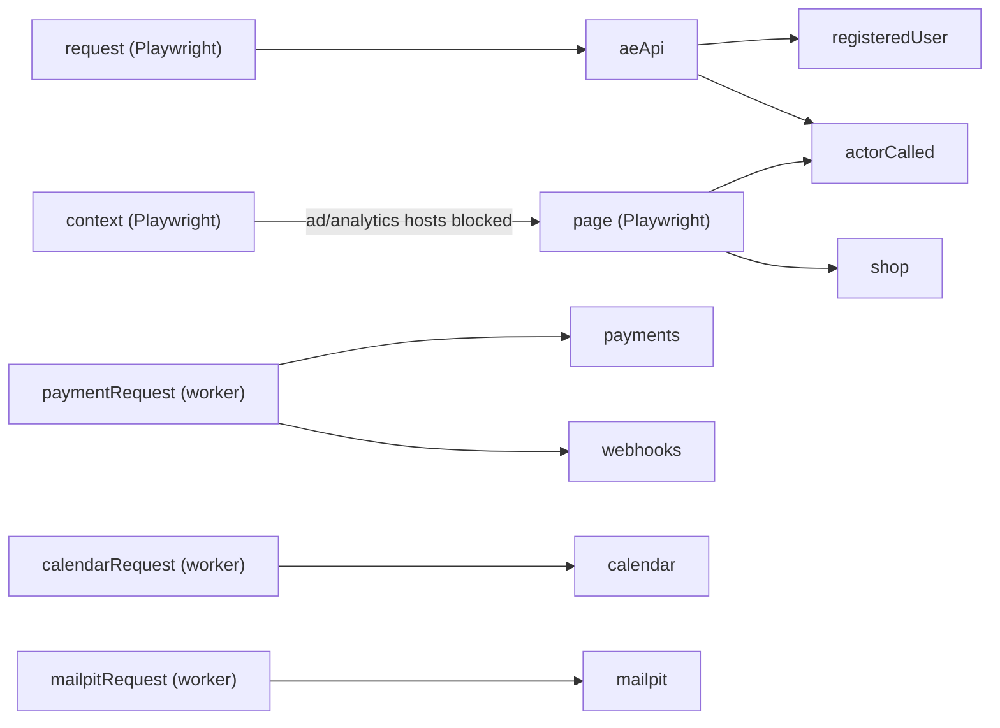

# Architecture

This document explains how the framework is put together, why, and how to extend it.
For setup and commands see the [README](../README.md).

## Layers and responsibilities

| Layer              | Location                        | Responsibility                                                           | Must not                                           |
| ------------------ | ------------------------------- | ------------------------------------------------------------------------ | -------------------------------------------------- |
| Specs              | `tests/`, `features/`           | Express _what_ is verified, own the assertions                           | Contain selectors or raw HTTP calls                |
| Fixtures           | `src/fixtures/`                 | Build dependencies per test, own setup/teardown, provide custom matchers | Hold test-specific logic                           |
| Screenplay         | `src/screenplay/`               | Business-level tasks and questions, step reporting                       | Define selectors                                   |
| Page objects       | `src/pages/`                    | Locators and intent-level UI actions                                     | Assert                                             |
| Clients            | `src/api/`, `src/integrations/` | Typed HTTP access plus response contracts                                | Know about test cases                              |
| Data               | `src/data/`                     | Valid, unique domain objects with overridable fields                     | Call systems under test                            |
| Config / utils     | `src/config/`, `src/utils/`     | Environment validation, logging, polling, transient retry                | Depend on higher layers                            |
| Simulated services | `services/`                     | Stand in for third parties, expose fault injection                       | Import from `src/` (they are a black box to tests) |

Dependencies point downwards only. The services are a separate program: tests reach them over
HTTP/SMTP exactly as they would a real provider. That is why `src/data/payment.factory.ts`
repeats the test-card numbers instead of importing them from `services/`.

## Key decisions and trade-offs

### Screenplay on top of POM, not next to it

A common failure mode is two abstractions over the same DOM: page objects for some tests,
Screenplay interactions with their own selectors for others. Here the `BrowseTheWeb` ability
exposes the page-object registry (`Shop`), and tasks call page-object methods. The cost is that
the Screenplay interaction layer is thin (only `Navigate`). The benefit is that one locator
change fixes every test.

### Assertions in specs, not in page objects

Page objects return locators or data, and the spec decides what is correct. That keeps a page
object reusable for negative tests (e.g. `login()` is used for both valid and invalid
credentials). The exception is tasks that must confirm a precondition to be meaningful (e.g.
`Login.withCredentials` checks the user really is logged in). Those checks state the
precondition and are not the subject of the test.

### Contracts with zod, parsed in the client

Every response is parsed against a strict schema inside the client (`parseBody`). Tests get typed
data, and unexpected fields or types fail at the boundary with the URL, the issues and the body
in the message. For the Automation Exercise API this also catches its quirk of always answering
HTTP 200 with the real status in `responseCode`.

### Local simulators instead of provider sandboxes

Sandboxes cannot be made to deliver a webhook twice, out of order, or after a merchant outage on
demand, and they need accounts and secrets. The simulators are about 1,000 lines of TypeScript on
`node:http` with no framework. They model the behaviours that matter for correctness:
idempotency keys, signed webhooks with retry, event sequencing, optimistic concurrency. They also
add a `/__control` API that is scoped per order, so fault injection in one test cannot affect a
parallel test.

### Per-test isolation instead of global cleanup

Nothing is purged globally (no "delete all mail", no "reset service"). Each test uses unique
users, orders, calendars and recipient addresses. That is what makes `fullyParallel` safe, and
it lets several developers or CI jobs share one Mailpit instance.

### Bounded, visible retry for the public site

The demo shop answers with a "queue full" page under load. `gotoResilient` and
`requestResilient` retry only on that signal (HTTP 429/5xx or the overload page), at most three
times, and add a `transient-aut-error` annotation each time. Any other failure surfaces
immediately. This is deliberately narrower than Playwright's test-level retries, which would
re-run the whole test for any error.

### TypeScript 6.0 instead of 7.0

TypeScript 7 (the native compiler) is available, but `typescript-eslint` 8.x supports TS < 6.1,
and type-aware lint rules (`no-floating-promises`, `strictTypeChecked`) are worth more here than
faster compilation.

## Fixture graph

Fixtures are lazy: an API test never launches a browser, because nothing it uses depends on
`page`. The HTTP contexts for the local services are worker-scoped. They carry no per-test state,
so sharing them saves setup time.

## Extending the framework

**A new page**: add `src/pages/<name>.page.ts` extending `BasePage`, register it in
`Shop` (`src/pages/index.ts`), and expose locators plus intent-level methods.

**A new business flow**: add a task in `src/screenplay/tasks/` built with `activity()`, and
export it from `src/screenplay/index.ts`. If the flow needs new UI actions, add them to the page
object first.

**A new API endpoint**: add a zod schema in `src/api/schemas/`, a method on the client that
calls `parseBody`, and negative cases with `aeApi.raw()`.

**A new third-party integration**: add a route module under `services/<name>/`, mount it in
`services/start-services.ts`, write a typed client in `src/integrations/`, expose it as a fixture
in `src/fixtures/index.ts`, and add its health URL to `webServer` if it runs as a separate process.

**A new BDD scenario**: write the `.feature` file, then add steps in `features/steps/`
that call existing tasks or clients. `npx bddgen` prints snippets for missing steps.

**Another environment**: set `BASE_URL` (and service URLs) in `.env` or the CI environment.
`src/config/env.ts` validates them at start-up.
