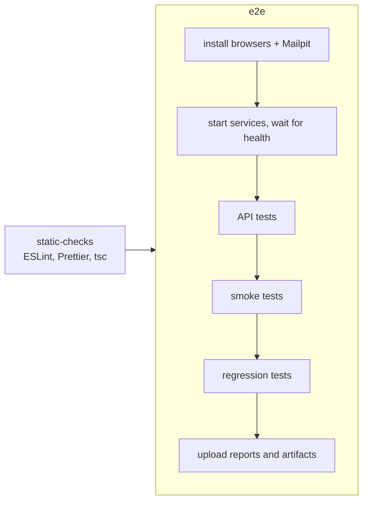

# CI/CD

Workflow file: [`.github/workflows/playwright.yml`](../.github/workflows/playwright.yml)

## Triggers

| Event               | When                                                 | Browsers                                     |
| ------------------- | ---------------------------------------------------- | -------------------------------------------- |
| `pull_request`      | PRs targeting `main`                                 | Chromium                                     |
| `push`              | Commits on `main`                                    | Chromium                                     |
| `workflow_dispatch` | Manually from the Actions tab; input `cross_browser` | Chromium, plus Firefox and WebKit if checked |
| `schedule`          | Nightly, 02:30 UTC                                   | Chromium, Firefox, WebKit                    |

Concurrent runs for the same PR are cancelled when a new commit arrives. Runs on `main` are never
cancelled.

## Jobs

### `static-checks`

`npm ci` → `npm run lint` → `npm run format:check` → `npm run typecheck`. The type check runs
`bddgen` first, so step definitions and generated specs are compiled too.

### `e2e`

1. `npm ci`, then Playwright browsers (cached by lock-file hash) and Mailpit (cached by
   install-script hash).
2. Mailpit and the simulators start in the background, with logs written to `.services/`. The
   step waits for `:8025/readyz`, `:4010/health` and `:4020/health` and fails with the logs if a
   service does not come up within 30 s. Playwright's `webServer` sees the running services and
   reuses them.
3. Three test stages run in sequence, each with `TEST_SUITE` set so reports go to
   `reports/<stage>/`:
   - `api`: `--project=api`
   - `smoke`: `--grep @smoke` over the integration, Chromium and BDD projects
   - `regression`: `--grep @regression` over the same projects

   A failing stage skips the stages after it (smoke gates regression).

4. Artifacts:

| Artifact                  | Uploaded         | Contents                                    |
| ------------------------- | ---------------- | ------------------------------------------- |
| `playwright-html-reports` | unless cancelled | `reports/<stage>/html`                      |
| `junit-results`           | unless cancelled | `reports/<stage>/junit/results.xml`         |
| `test-results`            | on failure       | traces, screenshots, videos of failed tests |
| `service-logs`            | on failure       | Mailpit and simulator stdout/stderr         |

## Security

- `permissions: contents: read`. The workflow cannot write to the repository, packages or PRs.
- No secrets are used. Values in `.env.example` are test-only credentials for the local
  simulators. They are defaults in code and safe to publish. Real credentials, if ever added
  (e.g. a staging `BASE_URL` behind auth), belong in GitHub encrypted secrets and must be passed
  through `env:`, never committed.
- `.env` is gitignored.

## Diagnosing failures

1. **Which stage failed?** Open the run. The failing step is one of _ESLint_, _Prettier_,
   _TypeScript_, _Start local services_, _API_, _Smoke_ or _Regression_. Playwright's `github`
   reporter adds inline annotations on the failing test lines in the PR diff.
2. **Static checks**: reproduce locally with `npm run check`.
3. **Services did not start**: the step prints `.services/*.log`. Typical causes: a port already
   in use, or a failed Mailpit download (GitHub release unavailable).
4. **Test failures**: download `playwright-html-reports` and open `reports/<stage>/html/index.html`
   with `npx playwright show-report <folder>`. For a failed test, download `test-results` and
   run `npx playwright show-trace <test-folder>/trace.zip`. The trace has DOM snapshots,
   network and console logs for each step. Screenplay tasks appear as named steps.
5. **Is it the environment or the product?**
   - A `transient-aut-error` annotation, or a page titled "This website is under heavy load",
     means the public demo site was overloaded. Re-run the job.
   - A test marked _flaky_ passed on retry. In the `integration` project this cannot happen
     (`retries: 0`). In UI/API projects treat it as a defect unless it carries the annotation above.
   - A failure in the `integration` project is never environmental. The services are local and
     deterministic.
6. **Reproduce locally** with the same stage command, e.g.
   `TEST_SUITE=smoke npx playwright test --grep @smoke --project=integration --project=chromium --project=bdd`.

## Validation status

The workflow has been checked locally: the YAML parses, the triggers, permissions and job graph
are as described above, and the exact command sequence of the `e2e` job runs successfully on
a developer machine. It has **not** yet run on GitHub-hosted runners. Add a status badge to the
README only after the first successful run.
